<div align="center">

# ⚡ FlashKraft

**Write an OS image to one USB stick — or ten at once — from your terminal, your desktop or your browser.**

Pure Rust from the UI down to the block device: no Electron, no `dd`, no shell scripts. Verified writes, safe drive selection, 43 themes.

[](https://crates.io/crates/flashkraft)
[](https://docs.rs/flashkraft-core)
[](LICENSE)
[](https://github.com/sorinirimies/flashkraft/actions/workflows/ci.yml)

[](https://crates.io/crates/flashkraft-tui)
[](https://crates.io/crates/flashkraft)
[](https://crates.io/crates/flashkraft-web)


</div>

---

## Choose your front-end

Same engine, same 43 themes, same safety checks — pick whichever fits how you work.

| Binary | What | Best for |
|---|---|---|
| [`flashkraft-tui`](crates/flashkraft-tui) | Terminal UI ([Ratatui](https://ratatui.rs)) | SSH, headless boxes, keyboard people |
| [`flashkraft`](crates/flashkraft-gui) | Desktop GUI ([Iced](https://iced.rs)) | Mouse, native file dialogs |
| [`flashkraft-web`](crates/flashkraft-web) | Web dashboard ([Topcoat](https://github.com/tokio-rs/topcoat)) | Seeing drives and image fit from a browser — read-only |

### 🖥️ Terminal UI — `flashkraft-tui`

Keyboard-driven, built-in file explorer, live theme preview, and a per-drive progress view.

| Pick the image | Mark several drives | Flash them all |
|---|---|---|
| 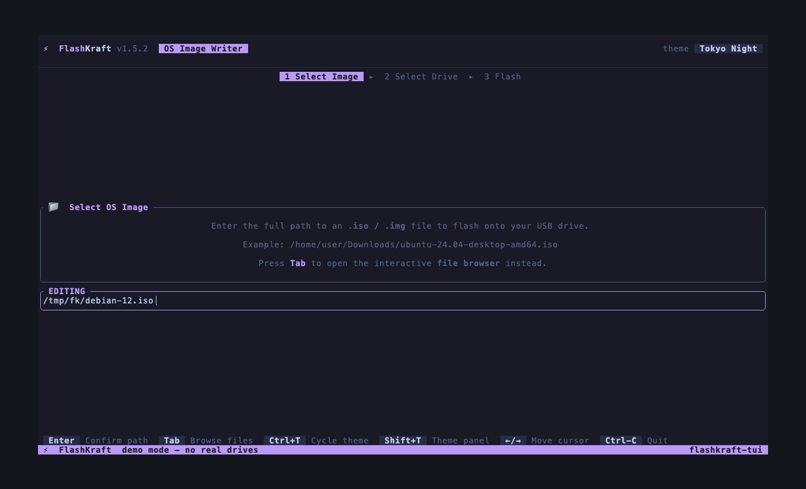 | 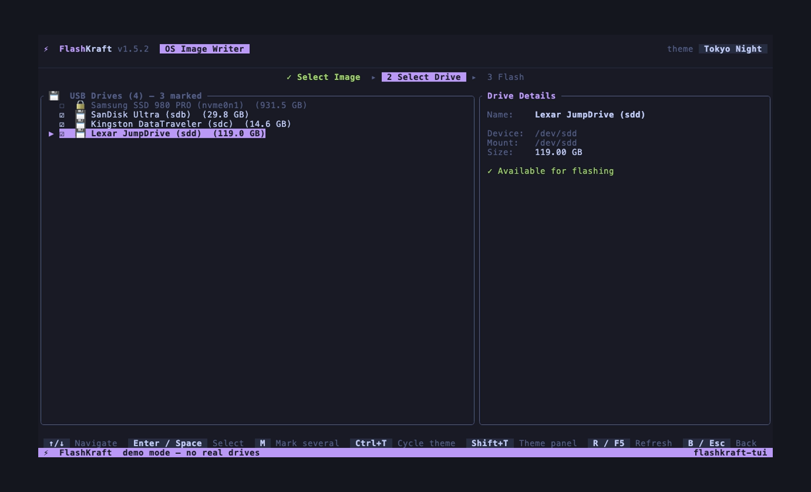 | 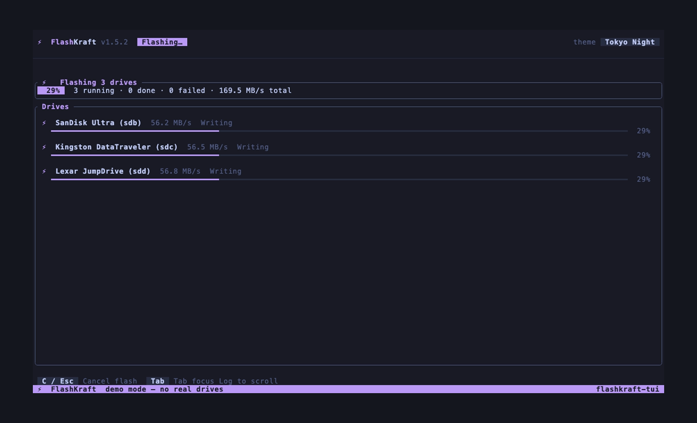 |


```sh
cargo install flashkraft-tui && flashkraft-tui
```

### 🪟 Desktop GUI — `flashkraft`

Cards that light up as each step is done, a drive picker with one-click multi-select, and a card per drive while flashing.

| Ready to flash | Mark several drives |
|---|---|
| 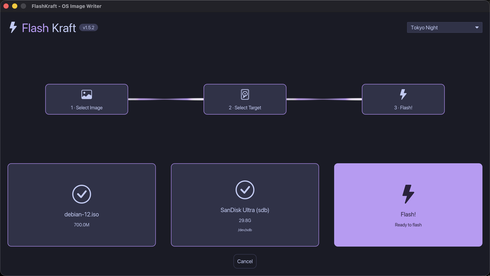 | 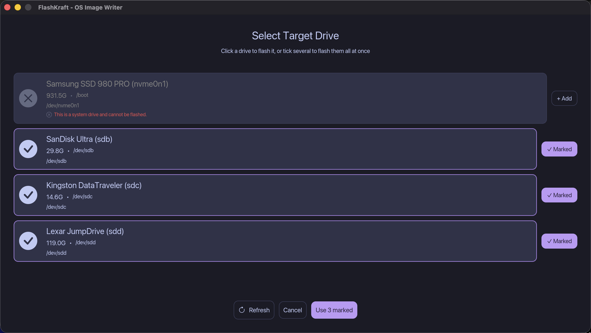 |

| Flashing three drives | Done |
|---|---|
| 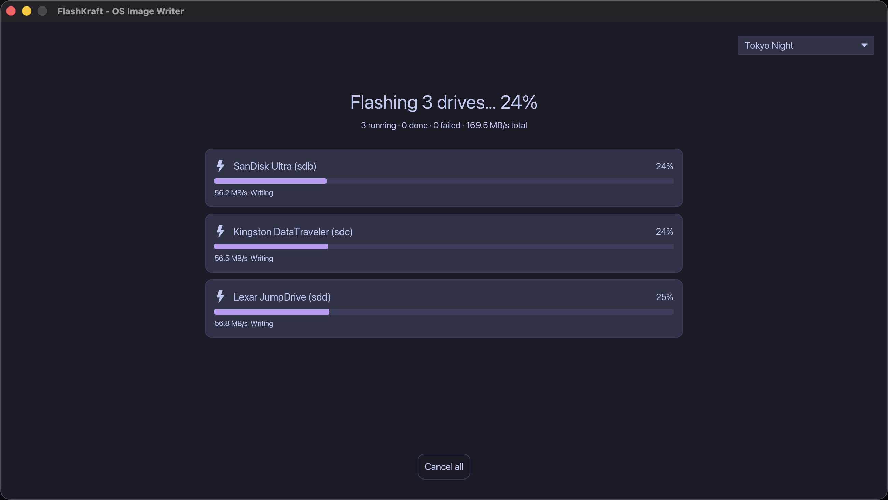 | 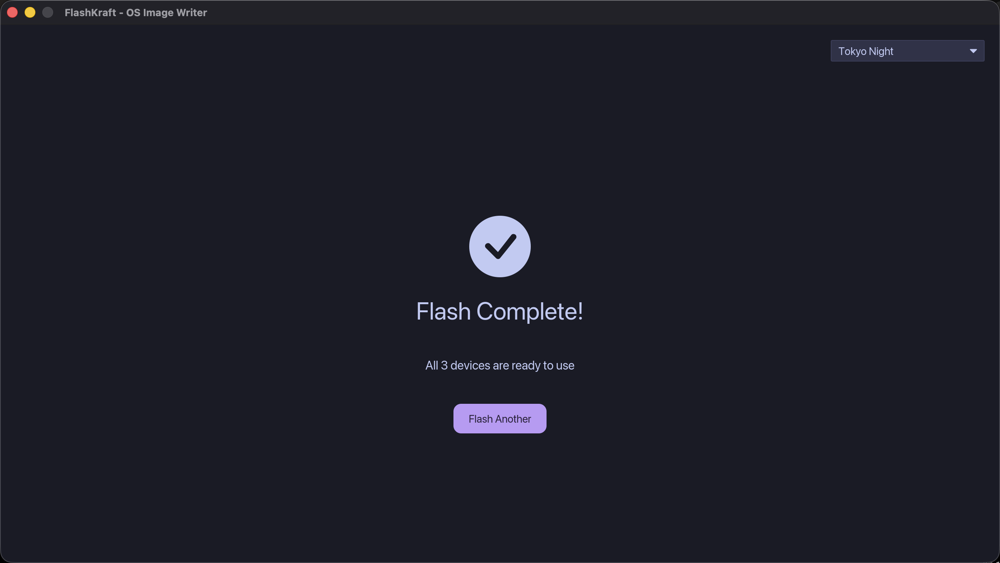 |

```sh
cargo install flashkraft
```

### 🌐 Web dashboard — `flashkraft-web`

A local, server-rendered page ([Topcoat](https://github.com/tokio-rs/topcoat)) in the same visual language. It lists the connected drives, shows whether an image fits each one, and keeps your flash history. Drives appear live over a WebSocket — plug a stick in and the table updates.

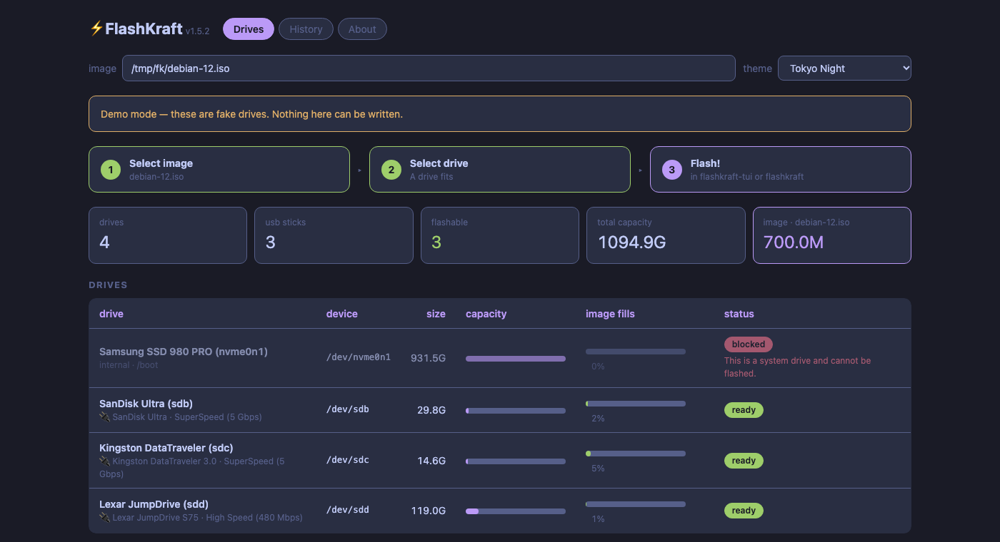

<details>
<summary>Medium, narrow and history views</summary>

| Medium | Narrow | History |
|---|---|---|
| 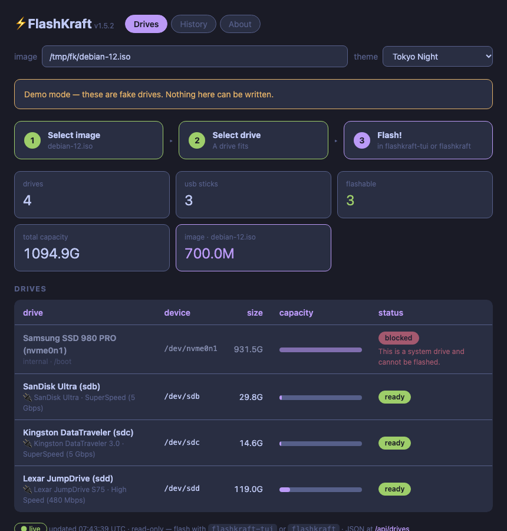 | 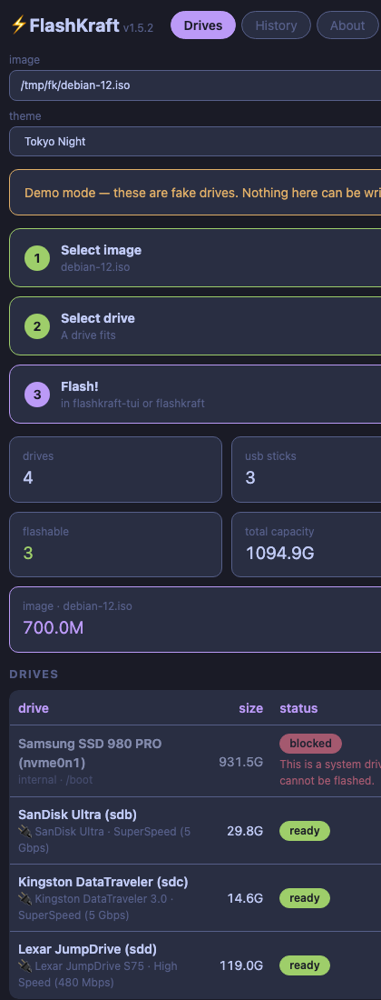 | 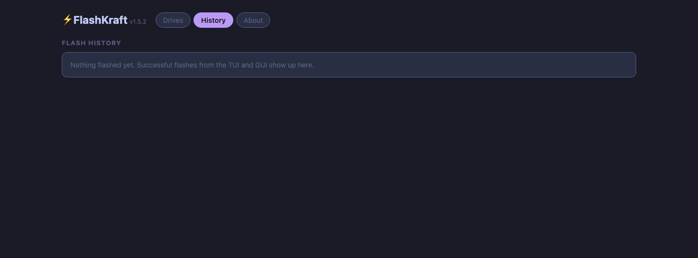 |

</details>

- Responsive on the same breakpoints as the TUI (wide ≥ 980 px, medium ≥ 700 px, narrow below)
- All 43 themes as CSS custom properties; `?theme=Nord`, or the one saved by the TUI
- `?image=/path/to.iso` checks the image against every drive
- JSON API: `/api/drives`, `/api/history`, `/api/themes`, `/api/health`
- **Read-only by design** — flashing needs raw device access, so it stays in the TUI and GUI. The server binds to `127.0.0.1` and never opens a device for writing

```sh
cargo install flashkraft-web
flashkraft-web                 # live mode needs the Topcoat bundle, see `just bundle-web`
flashkraft-web --demo          # fake drives
```

## Flash several drives at once

Mark any number of drives, press flash, and each gets its own worker, progress bar and verification.

- **TUI:** in the drive list press `m` on each drive, then `Enter`
- **GUI:** open *Select target* and click **+ Add** on each drive, then **Use N marked**
- Up to **4 drives are written in parallel** (USB hubs share bandwidth); the rest queue
- One failing drive never stops the others — you get a per-drive verdict at the end
- **Cancel** stops everything; queued drives never start
- Every drive is checked with the same safety rules as a single flash (no system disks, no read-only media, must be big enough)

Under the hood it is [`flashkraft_core::spawn_multi_flash`](crates/flashkraft-core/src/multi_flash.rs): one `Receiver<MultiUpdate>` carrying tagged per-device updates and one final summary, plus `MultiState` to fold the stream into UI state.

## Features

- ⚡ **Pure-Rust flash engine** — `std::fs`, `nix` ioctls and `sha2`; no `dd`
- 🔒 **Verified writes** — SHA-256 of the image is compared against a read-back of the device
- 🔄 **Partition-table refresh** — `BLKRRPART`, so the stick boots first time
- 🧲 **Lazy unmount** of every partition before writing
- 🛡️ **Safe drive selection** — system drives blocked, undersized and read-only drives refused, huge drives warned
- 🔌 **Hot-plug aware** — the drive list updates when you plug or unplug
- 🎨 **43 themes** shared by all three front-ends (`flashkraft-core`)
- 🧪 **Demo mode** — `FLASHKRAFT_DEMO=1` shows fake drives and *simulates* writes; it can never touch a real device

## How flashing works

On Unix, FlashKraft uses a checked **setuid privilege-drop** model. The installed binary immediately drops effective root before starting the UI or the Tokio runtime. The core pipeline temporarily regains root only for operations that need it:

```
Unprivileged GUI / TUI
  └─ flash worker (flashkraft_core::flash_worker)
       └─ pipeline thread
            1. UNMOUNTING  — detaches target partitions
            2. PREPARING   — opens the target once, exclusively, and checks its exact capacity
            3. WRITING     — streams exactly the snapshotted image length in 4 MiB chunks
            4. SYNCING     — fsyncs the retained handle
            5. REREADING   — refreshes the partition table through that handle
            6. VERIFYING   — re-hashes the image and reads the device back
            7. DONE        — releases ownership and reports success
```

The retained handle prevents `/dev/sdb` from resolving to a different device between writing and verification. Running interactively as root is rejected; launch the installed setuid binary as a normal user.

### The flash worker

Every front-end drives the pipeline through one shared worker ([`flash_worker.rs`](crates/flashkraft-core/src/flash_worker.rs)) instead of its own bridge code:

- **Exactly one verdict.** The stream always ends with one `Completed` or `Failed` — even if the pipeline thread panics or exits silently — so a UI can never wait forever.
- **No polling.** The worker blocks on the pipeline's channel and forwards updates the instant they exist (the TUI used to wake every 100 ms).
- **Honest cancel.** A cancel is reported only after the pipeline thread has really stopped writing the device.
- **Back-pressure.** The GUI bridge uses a blocking `send`; a plain `try_send` on a full channel used to kill the bridge mid-flash.
- **Pre-flight.** Missing, empty, non-regular or non-UTF-8 paths are rejected with a precise message before any thread starts.

### Why not `dd`?

| | `dd` | FlashKraft |
|---|---|---|
| Shell dependency | ✗ bash, coreutils | ✓ pure Rust |
| Progress | `\r`-terminated, locale-dependent | ✓ typed events |
| Write verification | ✗ none | ✓ SHA-256 read-back |
| Partition-table refresh | ✗ not done | ✓ `BLKRRPART` |
| Several drives at once | ✗ one process each | ✓ one click |
| Error reporting | ✗ exit code | ✓ message on every failure path |

## Keyboard (TUI)

| Screen | Keys |
|---|---|
| Select image | `i`/`Enter` edit path · `Tab`/`Ctrl+F` file browser · `Esc`/`q` quit |
| Select drive | `↑↓`/`jk` move · `Enter`/`Space` select · **`m` mark for multi-flash** · `r`/`F5` refresh · `b`/`Esc` back |
| Drive info | `f`/`Enter` continue · `b`/`Esc` back |
| Confirm | `y`/`Enter` flash · `n`/`b`/`Esc` back |
| Flashing | `c`/`Esc` cancel · `Tab` focus log |
| Complete / error | `r` start over · `q`/`Esc` quit |
| Anywhere | `Ctrl+T` next theme · `Shift+T` theme panel · `Ctrl+C`/`Ctrl+Q` quit |

## Installing

### Installing via Nix

The flake builds plain, unprivileged binaries into `/nix/store` — `nix run` alone is enough to browse images and enumerate drives, but the flash pipeline will refuse to open raw block devices with:

```
Cannot open target '/dev/sda' for exclusive read/write access: Unable to acquire
root privileges: EPERM: Operation not permitted. Raw devices require a
setuid-root FlashKraft installation.
```

This is expected: `/nix/store` paths are immutable and typically mounted `nosuid`, so a store binary can never carry the setuid bit itself. Two supported ways to get a working privileged install:

**NixOS** — use the flake's `nixosModules.default`, which wires up a proper `security.wrappers` entry (a setuid-root wrapper at `/run/wrappers/bin/flashkraft` that execs the real store binary):

```nix
{
  imports = [ flashkraft.nixosModules.default ];
  programs.flashkraft.enable = true;
}
```

Then launch the wrapper (first on `PATH` on NixOS), not `nix run`:

```bash
flashkraft
```

**Non-NixOS Nix** — build with Nix, then install with the setuid bit the same way `just install` does for a Cargo build:

```bash
just install-nix        # GUI
just install-nix tui    # TUI
```

### Build

```sh
git clone https://github.com/sorinirimies/flashkraft.git && cd flashkraft
cargo build --release                       # everything
cargo build --release -p flashkraft         # GUI
cargo build --release -p flashkraft-tui     # TUI
cargo build --release -p flashkraft-web     # web (Rust 1.98+, required by Topcoat)
```

Unix installs: a root-owned setuid binary via `just install`. GUI needs X11 or Wayland; the TUI works in any terminal.

### Develop

```sh
just test                 # whole workspace
just check-all            # fmt + clippy + tests + docs
just demo-web             # web dashboard with fake drives
FLASHKRAFT_DEMO=1 cargo run -p flashkraft-tui
```

## Regenerating the screenshots

Everything in `docs/media/` is generated in demo mode (fake drives, simulated writes, throw-away `HOME`) — never from real hardware.

```sh
just vhs-tui              # terminal GIFs + screenshots   (needs vhs)
just screenshots-gui      # desktop GUI                    (macOS, window must be frontmost)
just screenshots-web      # web dashboard                  (Chromium-based browser)
just media                # all of the above
```

`FLASHKRAFT_SCENE=ready|drives|batch|flashing|complete` puts the GUI into a canned state (demo mode only).

## Project structure

```
flashkraft/
├── crates/
│   ├── flashkraft-core/     shared logic — no UI deps
│   │   └── src/
│   │       ├── flash_helper.rs    privileged pipeline (unmount → write → sync → verify)
│   │       ├── flash_worker.rs    ★ one worker for every front-end: one verdict, no polling
│   │       ├── multi_flash.rs     ★ flash N drives at once + MultiState for UIs
│   │       ├── settings.rs        read the GUI/TUI settings + history (used by the web)
│   │       ├── commands/          drive detection, hot-plug, demo mode
│   │       ├── domain/            DriveInfo, ImageInfo, constraints, history
│   │       └── theme/             the 43 themes
│   ├── flashkraft-tui/      Ratatui app  (core/ state+update, ui/ screens+chrome)
│   ├── flashkraft-gui/      Iced app     (core/ Elm architecture, ui/ screens+components)
│   └── flashkraft-web/      Topcoat app  (pages, components, data, api, style, theme)
├── examples/vhs/            VHS tapes + the demo environment (setup.sh)
├── examples/capture/        GUI / web screenshot scripts
└── docs/media/              generated GIFs and screenshots (GIFs via Git LFS)
```

> GIFs are stored with [Git LFS](https://git-lfs.github.com/): run `git lfs install && git lfs pull` after cloning if they look broken.

## License

MIT © Sorin Irimies
